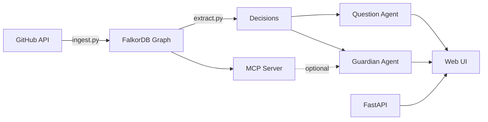

# Why? – A PR Guardian That Knows the Reasons

**Track 1: Agents that Act on Connected Data** | Graph Hacks 2026

Every developer has looked at strange code and wondered why it is that way. `git blame` says who changed a line and when, but the real reason lives in a PR discussion, a linked issue, or a review argument. When someone later changes that code, the reason is usually forgotten.

**Why?** ingests a public GitHub repository into a FalkorDB graph of people, commits, PRs, issues, files, and the decisions extracted from discussions. The graph powers two agents, with the Guardian as the main feature:

1. **The Guardian** checks a pull request against past decisions attached to its changed files, estimates blast radius, and suggests reviewers. It drafts an evidence-backed review comment only when it finds a conflict.
2. **The Question Agent** answers things like "why does this module retry three times?" or "who understands the auth code?" by walking the same graph.

Every answer and every action shows the **path the agent walked** (file → PR → issue → decision), because the hackathon brief asks for agents whose results can be explained. A graph query is visibly necessary for each result, not decoration over text search.

## Screenshots (placeholders)

Add the recorded screenshots to `docs/` before publishing:

- `docs/guardian.png` — Guardian verdict, decision source, and drafted comment.
- `docs/ask.png` — Ask answer and its trace graph.
- `docs/bus-factor.png` — flagged file analysis and its supporting PR graph.

## Architecture



**Data flow:**
1. `ingest.py`: Pull 150 merged PRs with files, commits, reviews, review comments, and linked issues. Cache every API response. Load into FalkorDB with MERGE (idempotent).
2. `extract.py`: For PRs with real discussion, ask the LLM for decisions (summary, rationale, rejected alternatives, affected files). Store as Decision nodes with DECIDED_IN and AFFECTS edges.
3. Question agent (`agent.py`): Function-calling loop over graph tools (search_decisions, find_file, file_history, pr_details, decisions_for_file, who_knows_file, related_files). Returns answer + traced subgraph.
4. Guardian (`guardian.py`): Fetches a PR from GUARD_REPO, streams its changed files and attached decisions, checks up to five candidates concurrently (ranked by patch overlap and graph proximity), and on conflict reports blast radius, collaboration-ranked reviewers, and an evidence-linked review comment. Every result labels source nodes by their real graph type.
5. MCP server (`mcp_server.py`): Exposes graph tools over stdio so the guardian can discover them programmatically (with an in-process fallback).

## Graph Schema

**Nodes:**
- `Person {login}`
- `Commit {sha, message, date}`
- `PullRequest {number, title, body, merged_at, url}`
- `Issue {number, title, body, url}`
- `File {path}`
- `Decision {id, summary, rationale, rejected_alternatives}`

**Relationships:**
- `(Person)-[:AUTHORED]->(PullRequest|Commit)`
- `(Person)-[:REVIEWED {comment_count}]->(PullRequest)`
- `(PullRequest)-[:CONTAINS]->(Commit)`
- `(PullRequest)-[:TOUCHES {additions, deletions}]->(File)`
- `(PullRequest)-[:FIXES|MENTIONS]->(Issue)`
- `(Decision)-[:DECIDED_IN]->(PullRequest|Issue)`
- `(Decision)-[:AFFECTS]->(File)`
- `(Person)-[:COLLABORATES_WITH {weight}]->(Person)` (shared files plus mutual PR reviews)
- `(File)-[:CO_CHANGED_WITH {shared_prs}]->(File)` (at least two eligible shared PRs)

**Indexes:** Range indexes on File.path, PullRequest.number, Issue.number, Person.login, Commit.sha, Decision.id. Full-text indexes cover File.path, Decision.summary/rationale, PullRequest.title/body, and Issue.title/body.

## How FalkorDB is used

- `db.py` creates the graph schema and indexes. Ingestion uses `MERGE` so rerunning it updates existing graph entities instead of duplicating them.
- Cypher traversals follow file history, decisions and their PR or issue sources, authors, reviewers, and linked files.
- Full-text indexes find candidate decisions and repository entities; the graph then follows their relationships.
- FalkorDB PageRank over `CO_CHANGED_WITH` ranks files in a Guardian change's blast radius.
- FalkorDB betweenness over `COLLABORATES_WITH` ranks reviewers. The stored score is reused by Bus Factor and Guardian.
- The stdio MCP server exposes the same graph tools used by the agents; when it is unavailable, the Guardian calls those tools in-process.

**MCP mode in the checked demo:** `local` (in-process FalkorDB tools). The Guardian attempts the local stdio MCP server first, then falls back to those same tools if MCP is unavailable or times out. `mcp_server.py` remains available for stdio clients; the browser app does not require a separate MCP process.

## Setup

**Prerequisites:** Python 3.11+, Docker, a GitHub token (optional but raises rate limit to 5000/hr), an OpenAI-compatible LLM endpoint.

```bash
# 1. Start FalkorDB
docker compose up -d

# 2. Install Python dependencies
pip install -r requirements.txt

# 3. Configure environment (copy .env.example to .env and fill in)
cp .env.example .env
# Edit .env: set GITHUB_TOKEN, LLM_MODEL (required), LLM_BASE_URL/API_KEY if not local

# 4. Verify the LLM endpoint
python check_llm.py

# 5. Ingest the repository
python ingest.py

# 6. Extract decisions from discussions
python extract.py

# 7. Start the web server
uvicorn server:app --host 0.0.0.0 --port 8000 --reload

# Open http://localhost:8000 in your browser
```

If another FalkorDB already uses port `6379`, set both `FALKORDB_HOST_PORT` and `FALKORDB_PORT` to the same free port in `.env` (for example, `6380`). If its browser UI uses port `3000`, set `FALKORDB_UI_HOST_PORT` to another free port.

**With make:**
```bash
make up         # start FalkorDB
make check      # verify LLM
make ingest     # pull PRs
make extract    # extract decisions
make serve      # start server
```

## Safety

- `DRY_RUN=true` is the default. The Guardian does not post comments or reviewer requests while dry-run is enabled.
- Write actions are restricted to the configured `GUARD_REPO`; requests targeting another repository are refused.
- Posted comments do not use `@` mentions. Suggested logins appear in backticks to avoid notifications.

## Usage

### Question Agent (Ask tab in UI, or CLI)

```bash
python agent.py "why does this project retry connections?"
```

The agent calls graph tools (find_file, file_history, decisions_for_file, pr_details) and returns an answer plus the exact nodes and edges it traversed.

### Guardian (Guardian tab in UI, or CLI)

```bash
# In dry-run mode (default):
python guardian.py <pr_number>

# To actually post (requires GUARD_REPO ownership and DRY_RUN=false):
# 1. Edit .env: DRY_RUN=false
# 2. python guardian.py <pr_number>
```

The guardian fetches the PR's changed files, looks for decisions attached to those files, checks for conflicts via LLM, computes blast radius and reviewers, then drafts a review comment. In dry-run mode it prints the comment; in live mode it posts to GitHub.

The streamed result always lists changed files and the decisions checked as “checked N of M.” A no-conflict result includes one reason per check. Decision lookup returns every attached decision; to keep the request inside its 120-second bound, the Guardian checks at most five candidates concurrently, ranked by patch text overlap plus graph proximity.

GitHub requests time out after 20 seconds, model calls after 60 seconds, MCP calls after 10 seconds (15 seconds maximum), and the whole Guardian run after 120 seconds. The Ask agent keeps a six-round cap. The web UI streams each Guardian step as it completes.

### Bus Factor Analysis

```bash
python analysis.py
```

Shows knowledge concentration per file and directory (share held by top person over the last 12 months), plus the people who connect the most areas of the codebase (via a betweenness score computed once per ingestion and stored on each Person node; NetworkX is the fallback). Bus Factor and reviewer suggestions read the same stored score. The page also compares distinct merged PRs touching `src/requests/sessions.py` in FalkorDB with the cached GitHub file data.

## Why a graph

The reason for a code choice is usually spread across a few places. A graph keeps those places connected:

- "Why does this module retry three times?" → find file → PRs that touched it → decisions in those PRs → issues where decisions were made → quote rationale.
- "Who understands the auth code?" → find files matching "auth" → PRs touching those files → people who authored or reviewed those PRs, weighted by recency.
- "Which files are likely affected by this change?" → files touched by this PR → PRs that touched those files → other files in those PRs (co-change), ranked by PageRank over the PR↔File structure.

For example, a change to a file can be connected to the PR that touched it, the discussion that explains why, and the people who reviewed it. A text search can find a phrase, but it cannot reliably answer who made a related choice, which file it affects, or what else changes with that file. Why? searches normalized words (for example, `Response.reason` becomes `response|reason`) and then follows those links in FalkorDB. The UI shows the small subgraph used for the answer or review.

For a Guardian check, the graph connects the changed file to previous decisions and their source PRs/issues. It also connects that file to related files and reviewers. That lets the result show its evidence path instead of returning a conflict label without an explanation.

## LLM Endpoint

Any OpenAI-compatible endpoint works. Set `LLM_BASE_URL`, `LLM_API_KEY`, and `LLM_MODEL` in `.env`. Examples:

- **OpenAI:** `LLM_BASE_URL=https://api.openai.com/v1`, `LLM_MODEL=gpt-4o`
- **OpenRouter:** `LLM_BASE_URL=https://openrouter.ai/api/v1`, `LLM_MODEL=anthropic/claude-3.5-sonnet`
- **Local (vLLM, Ollama, LM Studio):** `LLM_BASE_URL=http://localhost:8000/v1`, `LLM_MODEL=your-model`
- **OmniRoute gateway (default):** `LLM_BASE_URL=http://localhost:20128/v1`, `LLM_MODEL=auto/fast`

The model must support function calling (tool use). `check_llm.py` verifies this before you build anything else.

## Configuration Reference

See `.env.example` for all options. Key variables:

- `GITHUB_TOKEN`: Classic or OAuth token with public_repo scope (raises rate limit from 60 to 5000/hr)
- `LLM_MODEL`: Required. The model ID to use (no default; fails loudly if unset)
- `REPO`: Repository to ingest (default `psf/requests`)
- `GUARD_REPO`: A repo you own, used for guardian demos (default matches REPO; the guardian only writes here)
- `DRY_RUN`: When true, the guardian prints actions instead of sending them (default true)
- `MAX_PRS`: How many recent merged PRs to ingest (default 150)

## MCP Server (Optional)

The guardian can discover its tools via the Model Context Protocol. To use in Claude Desktop, add to `~/.config/claude-desktop/config.json`:

```json
{
  "mcpServers": {
    "why": {
      "command": "python",
      "args": ["C:\\path\\to\\mcp_server.py"],
      "env": {"PYTHONPATH": "C:\\path\\to\\Project"}
    }
  }
}
```

The guardian tries MCP first and falls back to in-process calls if unavailable. MCP mode is reported in `/api/stats`.

## API Endpoints

- `POST /api/guard` – run the guardian on a PR ({pr_number, repo?})
- `POST /api/guard/post` – post the drafted comment (requires DRY_RUN=false)
- `POST /api/ask` – ask a question ({question})
- `GET /api/graph/neighborhood?path=...` – subgraph around a file
- `GET /api/bus-factor` – knowledge concentration analysis
- `GET /api/stats` – graph stats, config, MCP mode
- `POST /api/ingest` – rerun ingestion
- `POST /api/extract` – rerun decision extraction
- `GET /api/examples` – example questions tailored to the loaded repo

## Project Structure

```
Project/
  config.py              # Environment-backed configuration
  llm.py                 # LLM client + shared JSON parser
  db.py                  # FalkorDB connection, schema, trace helpers
  github_client.py       # GitHub REST client with caching
  check_llm.py           # Step 0: verify endpoint works
  ingest.py              # Phase 1: ingest repo into graph
  extract.py             # Phase 2: extract decisions from discussions
  graph_tools.py         # Shared graph query functions (used by all agents)
  agent.py               # Phase 3: question agent
  analysis.py            # Phase 4: bus factor analysis
  mcp_server.py          # Phase 5: MCP server over stdio
  guardian.py            # Phase 6: the guardian agent
  server.py              # Phase 7: FastAPI server
  static/index.html      # UI (single-page, Cytoscape.js)
  tests/                 # Evaluation scripts
  .env.example           # Configuration template
  docker-compose.yml     # FalkorDB service
  requirements.txt       # Python dependencies
  Makefile               # Shortcuts for common tasks
```

## Limitations

- **Decision extraction quality** depends on the LLM and the discussion quality. Conservative by design: no real decision = no node.
- **Graph size:** 150 PRs is a representative sample, not exhaustive. Full-repo ingestion would take longer but is supported (raise MAX_PRS).
- **Conflict detection** is a heuristic (LLM judgment on patch vs. decision text). False positives and false negatives are possible.
- **Co-change and blast radius** assume past co-change predicts future co-change (usually true, but not always).
- **Bus factor** uses distinct qualifying merged PRs from the last 365 days. For each file, the top person's share is the number of those PRs they authored or reviewed divided by all qualifying PRs touching that file; each PR counts once per person. Release, bump, version, and PRs touching more than 15 files are excluded. The graph shows all denominator PRs and links the top person to the PRs counted in the numerator.
- **MCP integration** depends on subprocess management; fallback to in-process is always available.

## License

This is a hackathon demo built for Graph Hacks 2026. Dependencies are MIT/Apache-2.0 licensed. FalkorDB is SSPLv1.

## Demo: Creating a Guardian Test Case

See `DEMO.md` for instructions on creating a demo PR that deliberately undoes a past decision, so the guardian catches it.

The checked demo is [PR #2 on the configured fork](https://github.com/Ishant-kumar-singh/requests/pull/2). It changes `Response.reason` from `str` to `Optional[str]` in `src/requests/models.py`, reversing decision [PR #7437](https://github.com/psf/requests/pull/7437). The Guardian cites the actual PullRequest source node and URL stored in the graph.

## Fresh start on Windows PowerShell

```powershell
docker compose up -d
python -m venv .venv
.venv\Scripts\python.exe -m pip install -r requirements.txt
Copy-Item .env.example .env
# Edit .env: set GITHUB_TOKEN, GUARD_REPO, and LLM_MODEL; keep DRY_RUN=true.
.venv\Scripts\python.exe ingest.py
.venv\Scripts\python.exe extract.py
.venv\Scripts\python.exe scripts\create_response_reason_demo_pr.py
.venv\Scripts\python.exe scripts\run_guardian_demo.py 2
.venv\Scripts\python.exe analysis.py
.venv\Scripts\python.exe -m uvicorn server:app --host 127.0.0.1 --port 8000
```

Open `http://127.0.0.1:8000`. If `.env` already exists, keep it instead of copying the example over it. The app stays in dry-run mode until `DRY_RUN=false` is set explicitly.

## Blog Post

See `DEMO_SCRIPT.md` for the timed walkthrough and `BLOG.md` for the Guardian run against #7437.
